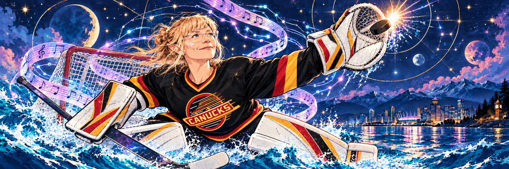

<p align="center">
  
</p>

# hey, i'm suzy. 🛸

**music // machines // vancouver**

Former professional bassist. Senior technical generalist. Creative technologist. Still making noise.

I used to tour in bands, live in recording studios and play bass through very large amplifiers. Now I build software, automation, cloud-connected systems and instruments that make computers feel a little less like computers.

The route here involved recording with Steve Albini, QA automation, production incidents, IT operations, identity and security, applied AI, and several thousand lines of code written because I wanted to hear what would happen.

> **The musician is the orchestrator. AI is another instrument, not the conductor.**

## SALTWATER // fish study 001

```text
                                      ___
                 ________         ___/   )
         _______/        \_______/      _)
    ____/                              _)
   /T                                 )
  <  \    (O)          \~             )
   \  \                >}~~~          /
    \  \       /       >>}}~~~~       /
     \  \_____/        >>>}}}~~~~    /
      \________        >>>}}~~~~    /
         /     \         }~~~~~    /
        /       \=        ~~~~    /
       (-\)      \\             /
       (\\)      (\\\)          /
        \V        \V)          /_________
                    \V)    \_\          \______
                            \_)  \\\\           \___
                                  \\\\\        /)))\
                                    \\)))    /))))))
                                      )))\__/\\\\\\
                                        ((\  \////
                                         (\\)
```

A fish made of punctuation. No image, no contribution chart, no engagement metrics. The odd little creature is the whole signal.

**[Source code / release the fish](experiments/saltwater-signal/fish.mjs)** · `node experiments/saltwater-signal/fish.mjs`

## now playing · november 2026

### 🍞 SUZY//TOAST / The Appliance Latent Space

On **October 29, 2026**, I performed my first solo electronic set at **Futureproof Festival** at Vancouver's H.R. MacMillan Space Centre: an AI-integrated interpretation of Radiohead's *Pyramid Song* built around live vocals, generative textures and layered audio loops.

The instrument ran locally on an **8GB MacBook Pro**. Underneath the performance interface:

- **Google Magenta RealTime 2 Small** generating musical audio, steered by MIDI and text-conditioned sound prompts
- A **Swift/macOS Audio Unit host**, **Python command bridge** and **JavaScript/Web Audio** performance surface
- Chord pads, native PCM capture, independent audio-loop layers and a hands-on mixer
- Live voice through a **Boss VE-22** and **Focusrite Scarlett Solo**

The original proposal involved turning an actual toaster into a physical instrument. The toaster didn't reach the stage. Its software descendants did. The hardware controller is still an experiment, not a finished product.

**[Explore SUZY//AI + TOASTER](https://github.com/suzyeaston/suzy-ai)** · [Read the engineering story](https://github.com/suzyeaston/suzyeastonca/blob/main/content/meanwhile/2026-11-an-orchestra-in-8gb.md) · [Read *The Toaster Was a Decoy*](https://www.suzyeaston.ca/2026/11/02/the-toaster-was-a-decoy/)

The earlier [Appliance Latent Space browser instrument](https://github.com/suzyeaston/appliance-latent-space-live) is still part of the public experiment trail.

### 📡 SUZY//PIRATE RADIO

Building a little independent internet station for original music, improvisation, field recordings and conversations. The **receiver and relay code exist**; the public stream isn't connected yet. No fake "live" broadcasts, no algorithm deciding what plays next.

**[Visit the receiver](https://www.suzyeaston.ca/radio/)** · [Explore the code](https://github.com/suzyeaston/suzyeastonca/tree/main/radio-station)

## other signals from the lab

| Project | Frequency |
| --- | --- |
| [**SUZY//AI**](https://github.com/suzyeaston/suzy-ai) | Open-source, local-first experiments in musical interaction, models, memory, MIDI and human-led performance. |
| [**POP//CONTEXT**](https://github.com/suzyeaston/pop-context) | An audiovisual evidence/input pipeline for SUZY//AI. Media observations are local and inspectable; integration into shared interpretation is still evolving. |
| [**SUZY//WORLD**](https://github.com/suzyeaston/suzy-world) | A deliberately published knowledge layer, built as a WordPress plugin with structured music entities, reviews and an API. |
| [**Lousy Outages**](https://www.suzyeaston.ca/lousy-outages/) | Independent status intelligence for cloud, AI and creative services. Because “all systems operational” isn't always the whole story. |
| [**suzyeaston.ca**](https://github.com/suzyeaston/suzyeastonca) | Custom WordPress/PHP and JavaScript workshop: Gastown Simulator, Loop Lab, Track Analyzer, Vancouver Tech Events, arcade experiments and field notes. |
| [**Skywhale Airways**](https://github.com/suzyeaston/skywhale-airways) | The weird, beautiful web-world orbiting *I AM NOMAD*, a psychedelic film made with Kris Krüg. 🐋 |

These are experiments at different stages, not six products pretending to be finished. I like working in public, keeping the useful bits legible, and allowing an idea to change shape.

## meanwhile, in the engine room

For **12+ years**, I've worked across support engineering, QA automation, IT operations, SaaS platforms, infrastructure and applied AI.

Most recently that has included **AI strategy and solutions engineering at Quercus IT**, working with Azure-hosted workflows, integrations and governance; **senior IT operations at Alida**, across Entra ID, Microsoft 365, endpoint management, security and automation; and earlier **software/QA and platform work at WineDirect**.

`Python` · `JavaScript / TypeScript` · `Swift` · `PowerShell` · `Bash` · `PHP` · `SQL / KQL`  
`Azure` · `AWS` · `Microsoft 365 / Entra` · `Intune / Defender` · `APIs` · `GitHub Actions` · `Cypress` · `Web Audio`

I like the complicated problems that live *between* disciplines: the integration nobody owns, the production bug nobody can reproduce, the musical idea that needs a new control surface, the workflow that could be a dozen lines of Python instead.

I'm interested in engineering, platform/IT, automation and applied-AI roles where that range is useful.

## the low frequencies

Before all this, I played bass in Vancouver bands including **Minto / The Smokes**, toured Canada, appeared on MuchMusic and recorded in Chicago with **Steve Albini**. I studied recording technology, composition and improvisation. I still approach systems a little like arrangements: listen carefully, find the pulse, leave room, and know when to mute a track.

Vancouver is home. I'm part of its creative-tech orbit, including **DCTRL** and **BC + AI**.

**[suzyeaston.ca](https://www.suzyeaston.ca/)** · [Meanwhile / field notes](https://www.suzyeaston.ca/meanwhile/) · [Music](https://suzyeaston.bandcamp.com/) · [All repositories](https://github.com/suzyeaston?tab=repositories)

*Saltwater. Low frequencies. Source code.*
